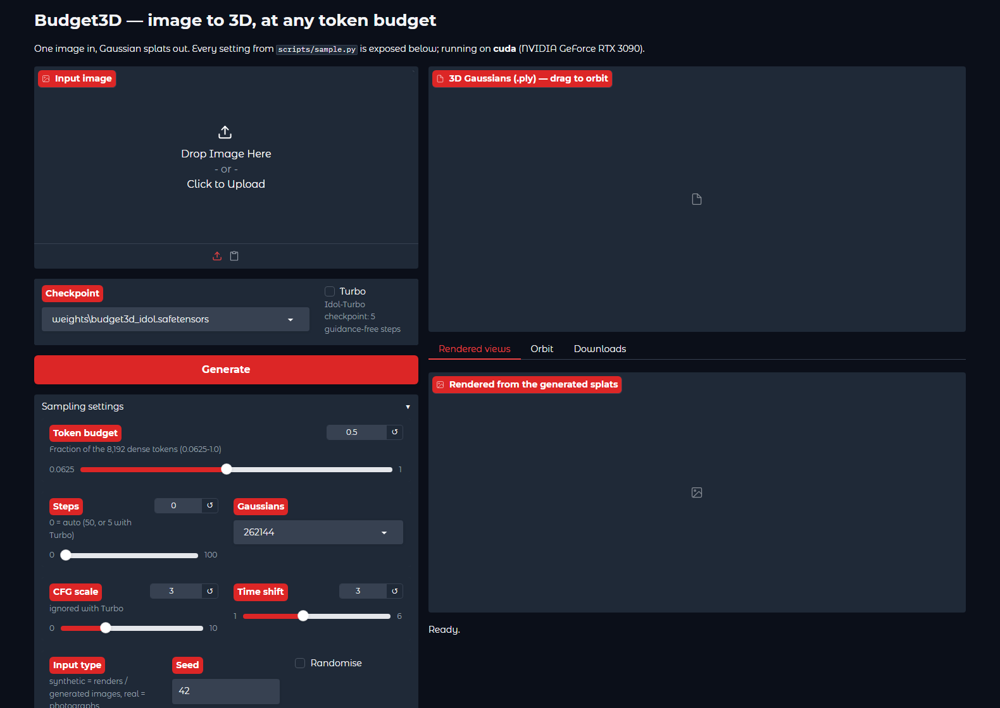

<p align="center">
  <picture>
    <source media="(prefers-color-scheme: dark)" srcset="docs/assets/brand/budget3d_dark.svg">
    
  </picture>
</p>

<h3 align="center">Budget3D — Web UI fork</h3>

<p align="center">
  A local, browser-based interface for Budget3D: one image → Gaussian splats, at any token budget.<br/>
  Fork maintained by <a href="https://github.com/RetroUpgrade-YouTube"><b>RetroUpgrade</b></a> ·
  original work by <a href="https://github.com/BudgetAny/Budget3D"><b>BudgetAny</b></a> (MIT)
</p>

> ### ⚠️ This is a fork — read the credit
>
> **All credit for the model, the method, the training code and the weights belongs to the original
> authors.** This fork adds a web interface and packaging around their code; it does not change the
> model, retrain anything, or claim any of it as new work. Upstream:
> **[BudgetAny/Budget3D](https://github.com/BudgetAny/Budget3D)** ·
> [project page](https://budgetany.github.io/budget3d/) ·
> [models](https://huggingface.co/BudgetAny).
>
> If the interface here is useful to you, please star and cite the original project — see
> [Credits](#-credits) and [Citation](#-citation). This fork is unofficial and not endorsed by the
> BudgetAny authors.

---

## 🖥️ What this fork adds

| | Upstream `BudgetAny/Budget3D` | This fork |
|---|---|---|
| **Interface** | CLI only (`scripts/sample.py`) | **Gradio web UI** (`webui.py`) — browser, live 3D |
| **Settings** | CLI flags | every flag, **plus** `warmup_steps`, `relayout_every` and `relayout_until_step`, which the CLI never exposes |
| **3D result** | `.ply` file | interactive viewer (`gr.Model3D`), labelled multi-view grid, **turntable MP4** |
| **Preview** | `scripts/gallery.py` writes an offline HTML page | in-browser, with resolution / angle / FOV / background controls |
| **Setup** | manual, several steps | `setup.bat` — one command (venv, deps, DINOv3 conversion, weights) |
| **Dependency fix** | — | `patches/` fixes Idol-SDK's diffusers call so the pinned environment runs at all |
| **Docs** | — | this README, plus `FORK_NOTES.md` with the full change list |



## ⚡ Quick start (Windows, CUDA)

Requires an NVIDIA GPU with a recent driver. Expect **~10 GB** of disk (Python env + weights).

```bat
git clone https://github.com/RetroUpgrade-YouTube/budget3d-webui
cd budget3d-webui

setup.bat          REM env, deps, DINOv3 conversion, weights  (~10-15 min, mostly download)
webui.bat          REM opens http://127.0.0.1:7860
```

`setup.bat` is idempotent — it skips anything already present, so it is safe to re-run.

For Linux/macOS, follow [Manual install](#-manual-install) below; the UI itself is cross-platform.

## 🎛️ Using the web UI

Drop an image (or click one of the bundled examples), set a **token budget**, press **Generate**.

**Input**

| Control | Meaning |
|---|---|
| Input image | upload / paste / example. Renders work best; use *Input type* for photos |
| Checkpoint | scans `weights/*.safetensors` — Idol, Idol-Turbo, or your own trained runs |
| Turbo | Idol-Turbo checkpoints only: 5 guidance-free steps instead of 50 |

**Sampling**

| Control | Meaning |
|---|---|
| Token budget | `0.0625`–`1.0` — fraction of the 8,192 dense tokens. The whole point of the model: one checkpoint, any budget |
| Steps | `0` = auto (50, or 5 with Turbo) |
| Gaussians | 65 536 – 524 288 anchor points decoded from the latent |
| CFG scale | classifier-free guidance (ignored with Turbo) |
| Time shift | Idol's shifted time grid (`rescale_t`) |
| Input type | `synthetic` for renders / generated images, `real` for photographs (changes Idol's crop margin) |
| Seed / Randomise | reproducibility, and the option to break it |

**Advanced sampling** — `warmup_steps` (dense steps before the budget applies), `relayout_every`,
`relayout_until_step` (`-1` = re-layout to the end), raw-vs-EMA weights, fast inference
(bf16 + fused attention + `torch.compile`; first run compiles), Turbo LoRA path.

**Preview render** — grid size, resolution, background, start yaw, pitch, camera radius, FOV, and
orbit video (frame count + fps).

**Output** — the interactive 3D viewer, the rendered-view grid, the turntable MP4, and downloads for
every artifact (`.ply`, PNGs, MP4). Runs are kept under `outputs/webui/<timestamp>/`.

Notes:
- The **first** Generate also loads the model + encoders (~15 s); later runs go straight to sampling.
- One GPU, one queue: a second Generate waits rather than fighting for VRAM.
- Turbo refuses a non-Turbo checkpoint on purpose — it would silently produce garbage.
- Measured on an RTX 3090: 45 s at 50 steps / 50 % budget, 26 s at 12 steps including a 72-frame orbit.

### CLI still works

The upstream interface is untouched:

```bash
python scripts/sample.py --ckpt weights/budget3d_idol.safetensors --image photo.jpg --budget 0.5 --out photo.ply
```

`run_sample.bat` wraps it on Windows and renders a turntable next to the `.ply`:

```bat
run_sample.bat path\to\your\image.png 0.5
```

`scripts/preview_ply.py` renders any upstream `.ply` to a PNG (it undoes the file's inverse
activations — sigmoid opacity logit, log-scale, quaternions and the z-up→y-up swap):

```bat
.venv\Scripts\python.exe scripts\preview_ply.py --ply outputs\your_image.ply --out view.png
```

## 🔧 Manual install

```bash
git clone https://github.com/RetroUpgrade-YouTube/budget3d-webui && cd budget3d-webui
git clone https://github.com/speridlabs/idol-sdk third_party/idol-sdk     # Idol's model code
git apply patches/idol-sdk-diffusers-dtype.patch --directory=third_party/idol-sdk

uv venv --python 3.12 .venv
uv pip install --python .venv/Scripts/python.exe torch==2.9.1 torchvision==0.24.1 \
    --index-url https://download.pytorch.org/whl/cu128
uv pip install --python .venv/Scripts/python.exe -r requirements.txt plyfile
uv pip install --python .venv/Scripts/python.exe gradio==5.49.1    # separate: see note below
uv pip install --python .venv/Scripts/python.exe --no-deps -e third_party/idol-sdk

.venv/Scripts/python.exe scripts/convert_dinov3_to_hf.py --model-name vith16plus_lvd1689m --save-dir weights/dinov3
```

Then download the weights (see [Download the weights](#download-the-weights)) and start the UI.

`gradio==5.49.1` caps `pillow<12` while `requirements.txt` pins `pillow==12.1.1`, so the two must be
installed in separate steps — Gradio then pulls pillow back to 11.3.0. Sampling is unaffected.

## 🧩 Why the patch exists

Idol-SDK calls `AutoencoderKLFlux2.from_pretrained(..., dtype=torch.bfloat16)`. That keyword only
exists in **diffusers ≥ 0.40**, but 0.40 requires `huggingface_hub ≥ 1.23` while Budget3D's pinned
`transformers==4.57.6` requires `< 1.0`. Those constraints cannot both hold, so upstream's
`diffusers==0.36.0` pin is correct and the call site must use the old spelling, `torch_dtype=`.

Without it, every run dies at the encoder stage with
`TypeError: AutoencoderKLFlux2.__init__() got an unexpected keyword argument 'dtype'`.
The patch picks the right keyword from the installed diffusers version, so it keeps working if the
pins move. It touches one line of a *vendored* dependency — no upstream file is modified.

## 🙏 Credits

This fork exists because of other people's work:

- **[Budget3D](https://github.com/BudgetAny/Budget3D)** — model, training code, weights, paper page.
  Everything that matters here is theirs. Maintained by **BudgetAny**.
- **[BudgetPix: Compute-Adaptive Tokenization for Pixel-Space Image Diffusion](https://arxiv.org/abs/2610.12307)**
  — Kara, Chen, Watson, Forsyth, Rehg, Chu & Tran (2026). Budget3D extends this method to image-to-3D.
- **[Idol](https://huggingface.co/speridlabs/idol) / [Idol-Turbo](https://huggingface.co/speridlabs/idol-turbo)**
  by **Sperid Labs** — the base image-to-3D model Budget3D fine-tunes, and the model code imported via
  [`idol-sdk`](https://github.com/speridlabs/idol-sdk).
- **[DINOv3](https://github.com/facebookresearch/dinov3)** (Meta) and the
  **[FLUX.2](https://huggingface.co/black-forest-labs) VAE** — the frozen image encoders.
- **[Dome-Objaverse](https://huggingface.co/datasets/zeyuanyin/Dome-Objaverse)** renders of
  [Objaverse](https://objaverse.allenai.org/) — training data.

The web interface, `scripts/preview_ply.py`, the setup/packaging and the patch in this fork were
written by [RetroUpgrade](https://github.com/RetroUpgrade-YouTube). If you reuse the UI code, a link
back is appreciated; if you reuse the model, cite the original authors (below).

## 📄 License

MIT, same as upstream — see [`LICENSE`](LICENSE). The fork's additions inherit it. Model weights are
Apache-2.0 (fine-tuned from Idol); DINOv3 and the FLUX.2 VAE carry their own licenses and are not
redistributed here.

---

# Upstream README (preserved)

The original project description follows, unchanged, so nothing is lost in the fork.

**Budget3D** brings compute-adaptive tokenization to image-to-3D generation. It fine-tunes
[Idol](https://huggingface.co/speridlabs/idol) and [Idol-turbo](https://huggingface.co/speridlabs/idol-turbo), which turn
one image into 3D Gaussian splats, so that one checkpoint runs at any token budget: the regions where the latent varies
least, empty space first, are merged into coarser tokens, and the full-resolution tokens go where it varies most.

> **Unofficial, open-source implementation.** Budget3D is part of [BudgetAny](https://budgetany.github.io/) and is based on
> the method of [BudgetPix: Compute-Adaptive Tokenization for Pixel-Space Image Diffusion](https://arxiv.org/abs/2610.12307)
> (Kara et al., 2026), which it extends beyond the paper to image-to-3D generation. It is not an official release. Thanks
> to the BudgetPix authors for the method.

<p align="center"></p>
<p align="center"><em>One checkpoint, any budget: the same input image, noise and camera at decreasing token budgets.</em></p>

## 🔥 News

- **Nov 2026:** Budget3D joins [BudgetAny](https://budgetany.github.io/), next to [BudgetPix](https://github.com/BudgetAny/BudgetPix) and [BudgetLatent](https://budgetany.github.io/budgetlatent/) (coming soon), with code and weights for Idol and Idol-turbo. The tech report is coming soon.

## 📦 Models

| Model | Base model | Task | Weights |
|---|---|---|---|
| Budget3D-Idol | [Idol](https://huggingface.co/speridlabs/idol) | Image-to-3D | 🤗 [BudgetAny/Budget3D-Idol](https://huggingface.co/BudgetAny/Budget3D-Idol) |
| Budget3D-Idol-Turbo | [Idol-turbo](https://huggingface.co/speridlabs/idol-turbo) | Image-to-3D, few steps | 🤗 [BudgetAny/Budget3D-Idol-Turbo](https://huggingface.co/BudgetAny/Budget3D-Idol-Turbo) |

## 🚀 Usage

#### Installation

Python 3.10+ and a CUDA GPU.

```bash
git clone https://github.com/BudgetAny/Budget3D && cd Budget3D
git clone https://github.com/speridlabs/idol-sdk third_party/idol-sdk      # Idol's model code
pip install -r requirements.txt -r third_party/idol-sdk/requirements.txt
python scripts/convert_dinov3_to_hf.py --model-name vith16plus_lvd1689m --save-dir weights/dinov3   # Idol's image encoder, converted once
```

#### Download the weights

```bash
hf download BudgetAny/Budget3D-Idol budget3d_idol.safetensors config.json --local-dir weights
hf download BudgetAny/Budget3D-Idol-Turbo budget3d_idol_turbo.safetensors config.json --local-dir weights
# Idol's own weights are downloaded from speridlabs on first use
```

#### Sample

`--budget` is the fraction of the tokens to use; `--mode real` uses Idol's crop for photographs.

```bash
python scripts/sample.py --ckpt weights/budget3d_idol.safetensors --image photo.jpg --budget 0.5 --out photo.ply    # 3D Gaussians (.ply)
python scripts/sample.py --ckpt weights/budget3d_idol_turbo.safetensors --turbo --image photo.jpg --budget 0.5 --out photo_turbo.ply
```

## 📚 Citation

Tech report coming soon. Until then, please cite the BudgetPix paper, whose method it builds on:

```bibtex
@article{kara2026budgetpix,
  title={BudgetPix: Compute-Adaptive Tokenization for Pixel-Space Image Diffusion},
  author={Ozgur Kara and Yujia Chen and Daniel Watson and David Forsyth and James Matthew Rehg and Wen-Sheng Chu and Du Tran},
  journal={arXiv preprint arXiv:2610.12307},
  year={2026}
}
```

## 📄 License

The code is released under the MIT License ([`LICENSE`](LICENSE)). The Budget3D weights are fine-tuned from
[Idol](https://huggingface.co/speridlabs/idol) and [Idol-turbo](https://huggingface.co/speridlabs/idol-turbo) (Apache-2.0)
and are released under Apache-2.0 as well. DINOv3 and the FLUX.2 VAE, which the models also need, are not part of this
release and come with their own licenses.

## 🙏 Acknowledgements

Budget3D builds on [Idol](https://huggingface.co/speridlabs/idol) and [Idol-turbo](https://huggingface.co/speridlabs/idol-turbo)
by Sperid Labs, whose model code it imports unmodified, on [DINOv3](https://github.com/facebookresearch/dinov3) and the
[FLUX.2](https://huggingface.co/black-forest-labs) VAE, and on the [Dome-Objaverse](https://huggingface.co/datasets/zeyuanyin/Dome-Objaverse)
renders of [Objaverse](https://objaverse.allenai.org/).

We acknowledge the compute support of the Health Care Engineering Systems Center within the Coordinated Science Lab at UIUC.
